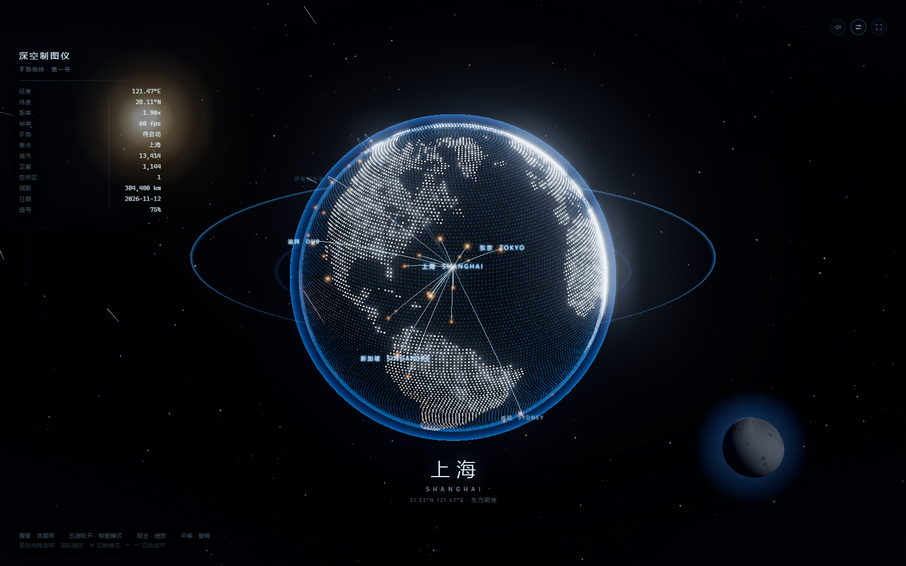
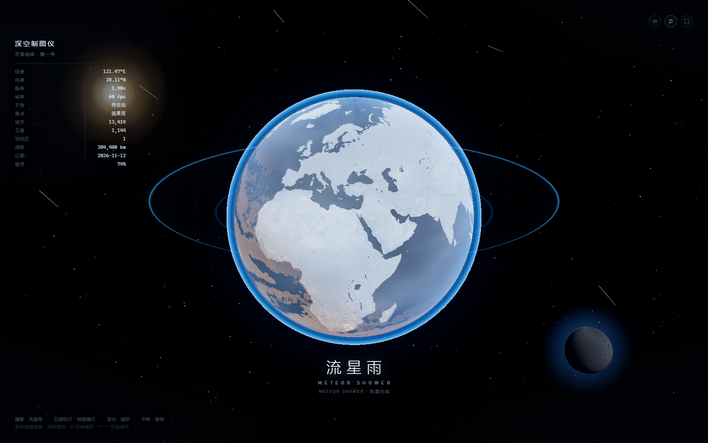

# 深空制图仪 · 手势地球（第一号）

Vue 3 + Vite + TypeScript + Three.js + MediaPipe HandLandmarker。
摄像头识别 21 个手部关键点，用手在空中「捏合 / 平移 / 握拳 / 张开」操控一颗**点阵地球**，并可在
「制图（chart）」与「流星雨（meteor）」两种视觉之间切换；左侧是深空制图仪表盘，底部是城市题注。

- 项目根目录：`E:\dev\particle-earth-hand`
- 本地地址：http://127.0.0.1:5173
- 两种模式实拍（1600×1000，Edge headless 截取）：

| 制图模式 chart | 流星雨模式 meteor |
| --- | --- |
|  |  |

---

## 1. 快速开始

```powershell
cd E:\dev\particle-earth-hand
npm run dev          # http://127.0.0.1:5173
```

首次克隆后若 `public/mediapipe/wasm` 与 `public/models/hand_landmarker.task` 缺失：

```powershell
npm run setup        # 复制 MediaPipe WASM + 下载手势模型
```

其它脚本：

```powershell
npm run type-check   # vue-tsc --noEmit
npm run build        # vue-tsc + vite build → dist/
npm run preview      # 预览构建产物
```

> 摄像头需要安全上下文：`127.0.0.1` / `localhost` 可以直接授权；用局域网 IP 打开需要 HTTPS。

---

## 2. 操作方式

### 摄像头隔空手势

| 手势 | 效果 |
| --- | --- |
| 捏合开合（拇指-食指距离） | 推远 / 拉近地球（距率 1.41×–3.10×） |
| 手掌平移 | 相机绕地球轨道旋转（经度 / 纬度跟随手掌） |
| 握拳并保持 | 切换到「流星雨」模式 |
| 五指张开并保持 | 回到「制图」模式 |

### 键盘 / 鼠标

| 输入 | 效果 |
| --- | --- |
| `M` / `空格` | 切换 制图 ⇄ 流星雨 |
| `←` / `→` | 上一个 / 下一个重点城市（题注与焦点同步切换） |
| `H` | 显隐 HUD |
| `F` | 全屏 |
| 拖拽画布 | 旋转视角 |
| 滚轮 | 缩放 |

停止操作 2.6s 后进入自动巡览：chart 模式下约每 9.5s（未检测到手时 5.2s）切换一座城市；
`?demo=0` 可关闭。

---

## 3. URL 调试参数

| 参数 | 说明 |
| --- | --- |
| `?preview=1` | 跳过摄像头授权，直接进入场景（截图 / 演示用） |
| `?mode=chart` / `?mode=meteor` | 指定初始模式 |
| `?city=上海` / `?city=San Francisco` | 指定初始焦点城市（中/英文均可） |
| `?demo=0` | 关闭自动巡览 |
| `?hide=clouds,atmos,dots,ring,halo,glossy,stars,sun,moon,cities,meteors,bloom` | 逐层隐藏，用于排查渲染层 |

示例：`http://127.0.0.1:5173/?preview=1&mode=meteor&city=伦敦`

---

## 4. 目录结构

```
E:\dev\particle-earth-hand
├─ index.html
├─ src
│  ├─ App.vue                     # 外壳：品牌栏 / 左侧仪表盘 / 底部题注 / 手势提示 / 摄像头授权门
│  ├─ components
│  │  └─ ParticleEarth.vue        # Three.js 场景全部逻辑（点阵地球 / 流星雨 / 城市网络 / 后处理）
│  ├─ three
│  │  └─ cities.ts                # 50 座城市数据、FEATURED 重点城市、经纬度 → 单位向量
│  ├─ composables
│  │  └─ useHandTracking.ts       # MediaPipe 初始化、摄像头、逐帧关键点 → 捏合/伸展/掌速
│  └─ styles
│     └─ main.css                 # 全局样式（深空配色、等宽数字、辉光）
├─ public
│  ├─ textures                    # earth-day / earth-night / earth-water / 云层
│  ├─ mediapipe/wasm              # 本地 WASM（npm run assets:mediapipe）
│  └─ models/hand_landmarker.task # 本地手势模型（npm run model:download）
└─ docs
   ├─ reference-spec.md           # 参考视频逐帧解析出的视觉规范
   └─ screenshots                 # chart.png / meteor.png
```

---

## 5. 实现要点

**相机轨道代替地球自转。** 参考视频里被选中的城市永远正对镜头，所以不做地球自转，
而是让相机绕原点做球面轨道运动：`camAz` 取城市经度、`camEl` 取纬度，城市方向即视线方向。

**点阵地球是自定义 ShaderMaterial 的 Points。** 顶点按经纬度规则排布（不是 Fibonacci），
贴图采样 `earth-water.png` 得到水陆掩码：
- 陆地：亮白点 `#dfeeff`，随昼面加亮，大小与亮度轻微随机
- 海洋：暗蓝点 `#143a5c`，暗但整球可见，形成经纬网格的「制图」质感
- 夜面城市灯：从 `earth-night.jpg` 取亮部，转为暖金色点

**所有「屏幕构图元素」都挂在相机上。** 太阳、点阵月球、倾斜轨道环、大范围辉光、流星
都是 `camera` 的子对象（`scene.add(camera)` 才能渲染），因此相机旋转时构图恒定，
只有星野是**世界坐标**的 Points，用来在轨道运动时产生视差。

**光照方向在相机空间固定。** 从右上打光（`SUN_LIGHT_CAM = (0.52, 0.46, 0.72)`），
每帧用 `applyQuaternion(camera.quaternion)` 转到世界空间，避免背面打光导致可见面变暗。

**流星雨模式的实体地球用线性空间手写着色。** 自定义 ShaderMaterial 的输出会被
`OutputPass` 再做一次 ACES + sRGB 编码，因此颜色必须直接写**线性值**，不能塞 `THREE.Color`；
法线/视线/光源全部换到 view 空间计算 fresnel，否则 fresnel 恒接近 1，整球惨白过曝（此前的 bug）。
陆海分界复用 `earth-water.png` 掩码，夜面叠加暖金城市灯，云层用贴图做低强度叠加。

**后处理。** `RenderPass → UnrealBloomPass → OutputPass`；bloom 的 strength / threshold
随模式插值（meteor 阈值更高），避免大亮盘整体泛光糊成一片。

**HUD 遥测每帧合并推送。** 场景把 `Telemetry`（模式、城市、经纬度、距率、帧率、手势、
城市数、卫星数、信号、本地日期）通过 emit 推给 `App.vue`，再以竖排 12 行渲染；数字用等宽
字体 + `font-variant-numeric: tabular-nums` 防止跳动。

---

## 6. 已知限制

- MediaPipe 在部分核显机器上只能回落 CPU 推理，帧率约 24–30fps；场景本身在 60fps 以上。
- 手势阈值（捏合/伸展）按当前环境调过，换光照或摄像头可能需要微调
  `useHandTracking.ts` 中的 `SMOOTH_*` 与 `ParticleEarth.vue` 里的 `spread > 0.72` / `< 0.34`。
- 城市标签做了屏幕空间过滤（避开左侧面板与底部题注），城市极密集时仍可能相邻重叠。
